<div align="center">


# 🎸 VinylDex

### Colleziona. Scambia. Domina la classifica.

Il gioco di carte collezionabili a tema musicale, con un **hotel in pixel art in tempo reale**,
battaglie online, mercato fra giocatori e oltre 140.000 carte da più di 20 giochi di carte.

[](https://github.com/JusTMeth25/FS0226IT--CAPSTONE/actions/workflows/ci.yml)
[](https://vinyldex.duckdns.org)
[](https://vinyldex.duckdns.org/api/docs)
<br />


**[🌐 Gioca ora](https://vinyldex.duckdns.org)** · **[📖 API Docs](https://vinyldex.duckdns.org/api/docs)** · **[🚀 Avvio rapido](#-avvio-rapido)** · **[🧪 Test](#-test)**

</div>

---

<p align="center">
  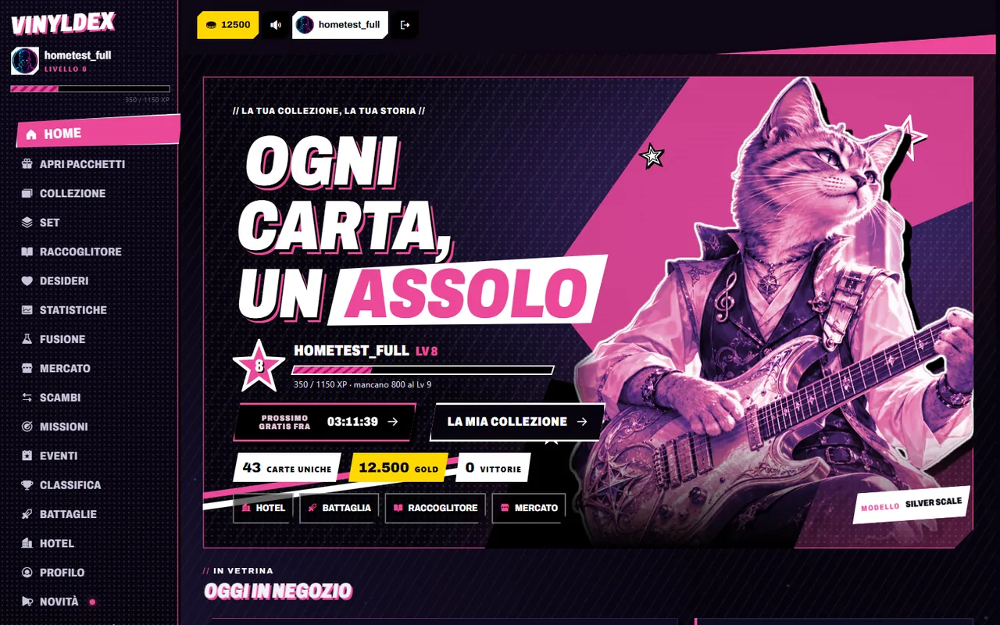
</p>

## 📑 Indice

- [✨ Cosa si può fare](#-cosa-si-può-fare)
- [📸 Screenshot](#-screenshot)
- [🛠️ Tecnologie](#️-tecnologie)
- [🏗️ Architettura](#️-architettura)
- [🚀 Avvio rapido](#-avvio-rapido)
- [🧪 Test](#-test)
- [📖 API Docs](#-api-docs)
- [🔐 Sicurezza](#-sicurezza)
- [♿ Accessibilità](#-accessibilità)
- [📦 Deploy](#-deploy)
- [📱 App mobile](#-app-mobile)
- [🗂️ Struttura del repository](#️-struttura-del-repository)
- [⚖️ Note legali](#️-note-legali)

---

## ✨ Cosa si può fare

| | Area | In breve |
|---|---|---|
| 🎁 | **Pacchetti** | Apertura con strappo in 3D (Three.js), pacchetto gratis a tempo, leggendaria garantita dopo una serie sfortunata, pacchetti per gioco e del weekend. Le carte le estrae **sempre il server**. |
| 🃏 | **Collezione** | Oltre **140.000 carte** da 23 fonti: le originali VinylDex e più di 20 giochi (Pokémon, Magic, Yu-Gi-Oh!, One Piece, Lorcana, Digimon, Dragon Ball, Weiss Schwarz, Vanguard, EA FC 27, NBA…). Filtri, valore di mercato, carte olografiche, gradazione del perito. |
| 📒 | **Raccoglitore 3D** | Un album da sfogliare in 3D, con le pagine che si girano. Poi set da completare, lista dei desideri e fusione delle doppie. |
| ⚔️ | **Battaglie** | Squadre di 3 carte su 3 round: contro gli NPC, contro la squadra di un altro giocatore o **online in tempo reale**. Bonus di squadra e abilità speciale. |
| 🏆 | **Coppa VinylDex** | Torneo a eliminazione diretta da 16 posti, con il tabellone aggiornato dal vivo per tutti. |
| 🏨 | **Hotel in pixel art** | Stanze isometriche in **tempo reale via WebSocket**. Avatar personalizzabili, chat, NPC con intelligenza artificiale, arredamento della propria stanza, feste, jukebox Spotify, meteo. |
| 🎮 | **Minigiochi** | 21 minigiochi: bowling, canestro, biliardo, golf, rock band, karaoke, disco, kart, pesca e altri. Poi il casinò (roulette, blackjack, poker, slot, bingo, corse dei cavalli) con fiches. |
| 💱 | **Economia** | Mercato fra giocatori, scambi con proposte e controproposte, scambi con gli NPC, borsa con titoli dei giochi, banchetti nell'hotel. Solo **gold** di gioco, nessun denaro reale. |
| 🎯 | **Progressione** | Livelli e XP, missioni giornaliere, eventi a orario, classifiche, carta del giorno, club. |
| 👤 | **Account** | Registrazione, accesso con **Google e Apple**, verifica in due passaggi (TOTP), dispositivi fidati, recupero della password via email. |
| 🛠️ | **Pannello admin** | Gestione di utenti, carte, pacchetti, eventi e moderazione della chat. |
| ♿ | **Accessibilità** | Modalità sicura per l'epilessia, colori per il daltonismo, alto contrasto, navigazione da tastiera e **controller**. |

---

## 📸 Screenshot

<table>
  <tr>
    <td width="50%">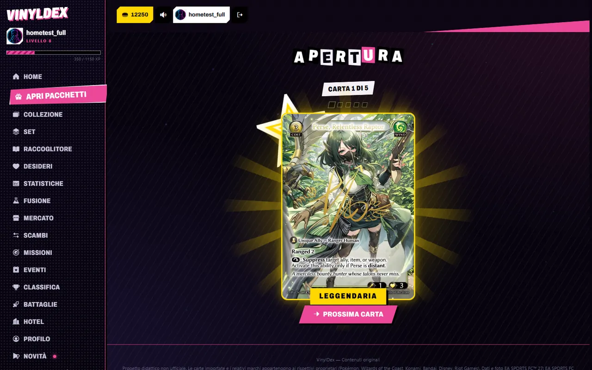<br /><sub>🎁 Apertura di un pacchetto, carta leggendaria</sub></td>
    <td width="50%">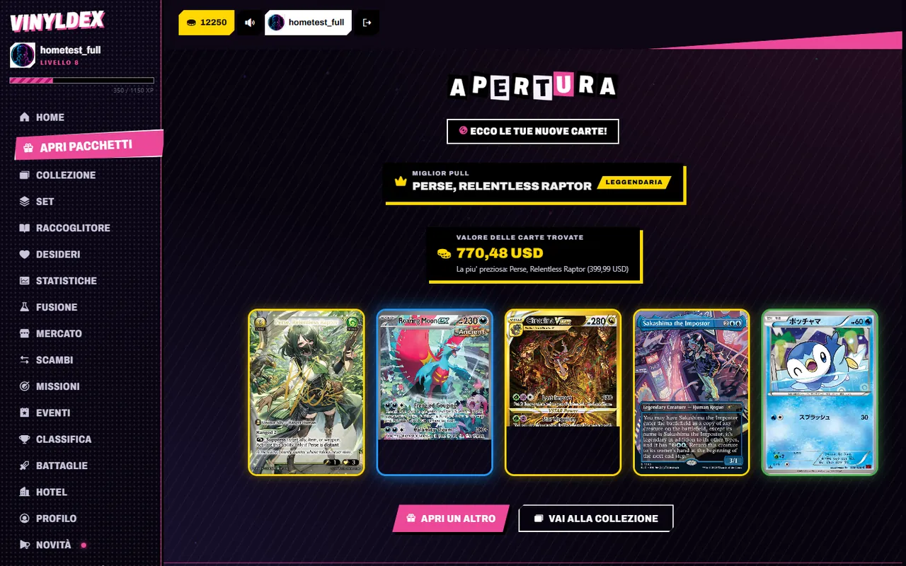<br /><sub>💎 Riepilogo con il valore delle carte trovate</sub></td>
  </tr>
  <tr>
    <td>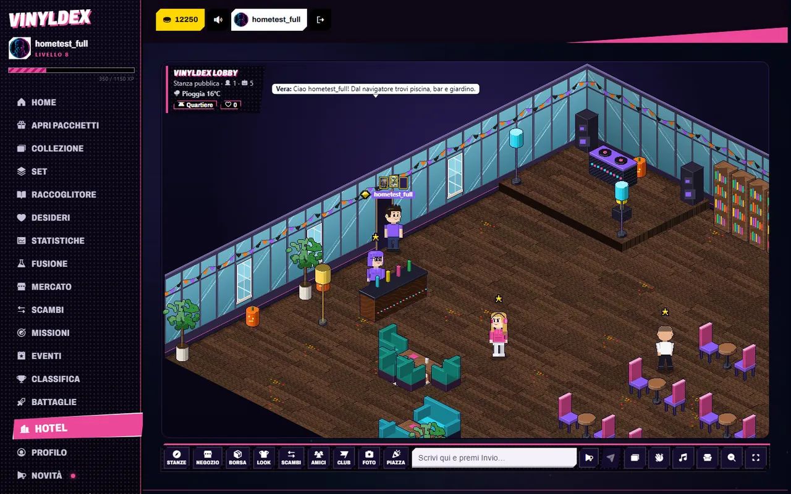<br /><sub>🏨 La lobby dell'hotel, in tempo reale</sub></td>
    <td>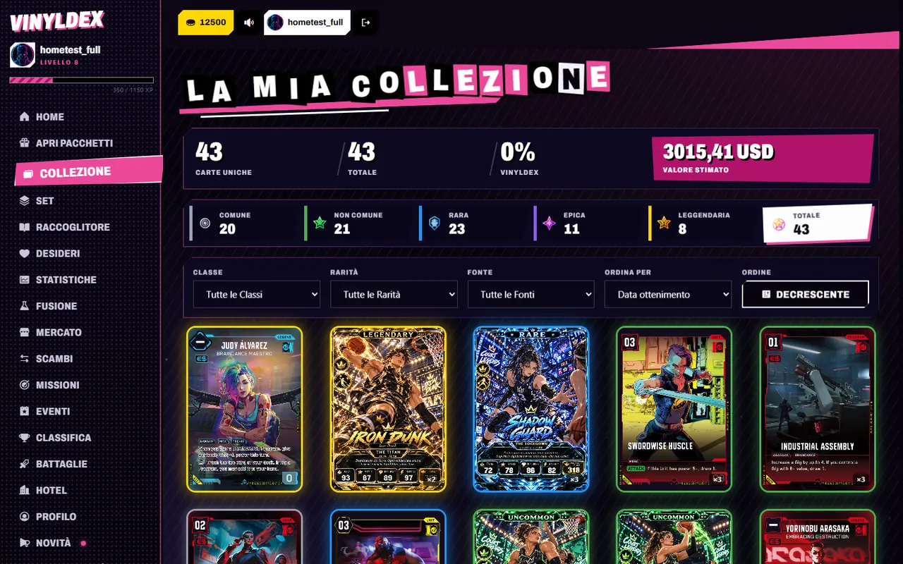<br /><sub>🃏 La collezione con filtri e statistiche</sub></td>
  </tr>
  <tr>
    <td>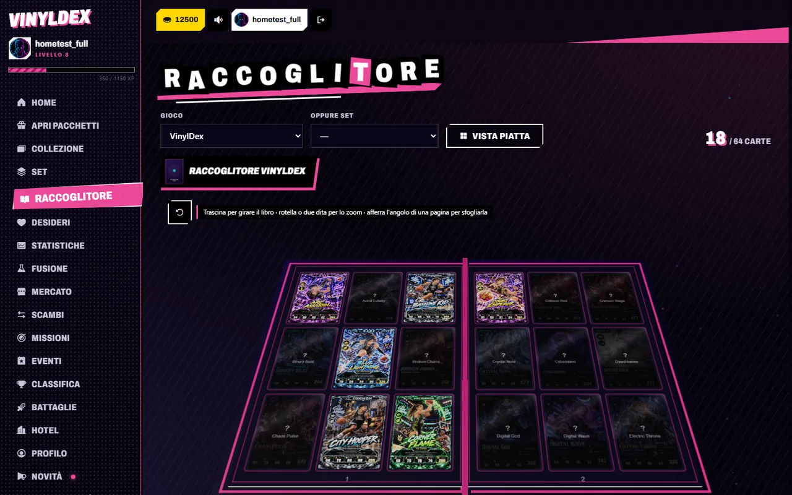<br /><sub>📒 Il raccoglitore da sfogliare in 3D</sub></td>
    <td>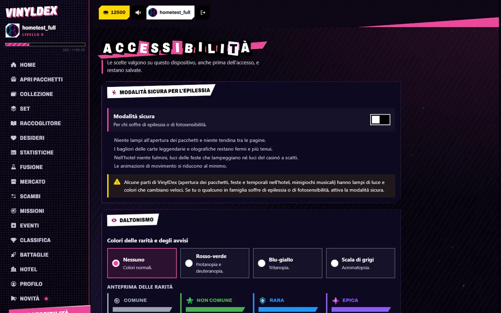<br /><sub>♿ Impostazioni di accessibilità</sub></td>
  </tr>
</table>

<p align="center">
  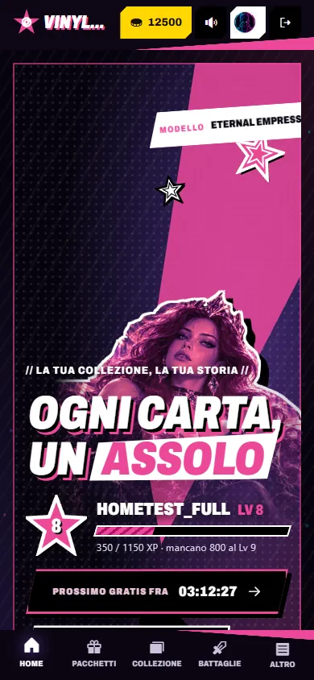
  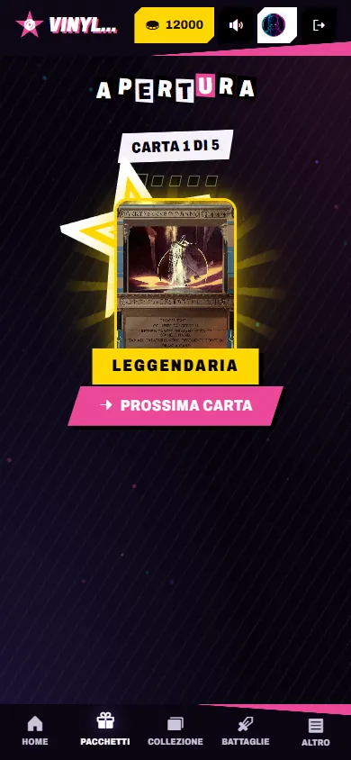
  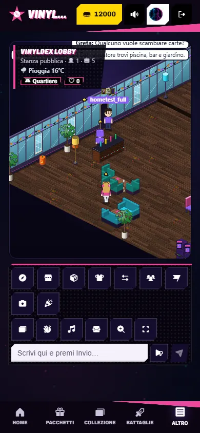
  <br /><sub>📱 Su telefono: tutto il sito è responsive, anche in orizzontale</sub>
</p>

---

## 🛠️ Tecnologie

| Livello | Stack |
|---|---|
| 🎨 **Frontend** | React 19, Vite, React Router 7, Motion, Three.js + React Three Fiber, Canvas 2D (motore dell'hotel), Phosphor Icons, PWA con service worker |
| ⚙️ **Backend** | Java 25, Spring Boot 4.1, Spring Security, Spring Data JPA (Hibernate), WebSocket, Flyway, JJWT, springdoc-openapi |
| 🗄️ **Database** | PostgreSQL 18, con lo schema versionato da 86 migrazioni Flyway |
| 📱 **Mobile** | Capacitor 8 (iOS e Android), login nativo con Google e Apple |
| 🧪 **Test** | JUnit 5 + Spring Boot Test (unitari e di integrazione), JaCoCo, Vitest + Testing Library, Playwright |
| 🚀 **Infrastruttura** | Docker Compose, Caddy (HTTPS automatico, Content-Security-Policy), GitHub Actions, Brevo (email) |

---

## 🏗️ Architettura

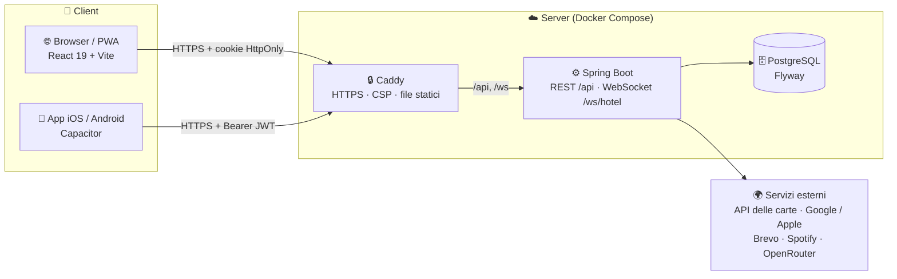

- **Il server decide tutto ciò che vale qualcosa:** carte estratte, probabilità, ricompense, esiti delle
  partite. Il client manda solo l'evento.
- **I gold passano solo da `WalletService`**, con blocco della riga e registro di ogni movimento.
- **L'hotel** è un motore a stanze in memoria: ogni stanza ha il suo ciclo di aggiornamento e manda gli stati ai
  giocatori collegati via WebSocket.

Più dettagli in [`BE/README.md`](BE/README.md) e [`frontend/README.md`](frontend/README.md).

---

## 🚀 Avvio rapido

### 📋 Requisiti

| Strumento | Versione | Verifica |
|---|---|---|
| ☕ JDK | 25 | `java -version` |
| 🟢 Node.js | 20 o superiore | `node -v` |
| 🐘 PostgreSQL | 16 o superiore | `psql --version` |
| 🔧 Git | qualsiasi | `git --version` |

> Maven non serve: il progetto include il wrapper `./mvnw`.

### 1️⃣ Clona il repository

```bash
git clone https://github.com/JusTMeth25/FS0226IT--CAPSTONE.git
cd FS0226IT--CAPSTONE
```

### 2️⃣ Crea il database

```bash
createdb -U postgres -E UTF8 vinyldex
```

Lo schema lo crea Flyway al primo avvio del backend, non serve altro.

### 3️⃣ Configura il backend

```bash
cd BE
cp .env.example .env
```

Apri `BE/.env` e compila i due valori obbligatori (`DB_URL` punta già al database `vinyldex`):

```properties
DB_PASSWORD=la-password-del-tuo-utente-postgres
JWT_SECRET=una-stringa-casuale-di-almeno-32-caratteri   # openssl rand -hex 48
```

Tutte le altre chiavi (API delle carte, Google/Apple, email, Spotify, NPC con intelligenza artificiale) sono
**facoltative**. Senza, quelle funzioni restano spente o usano dati di riserva. L'elenco completo, commentato,
sta in [`BE/.env.example`](BE/.env.example).

### 4️⃣ Avvia il backend

```bash
./mvnw spring-boot:run        # Windows: mvnw.cmd spring-boot:run
```

L'API risponde su **http://localhost:4000** (salute: `GET /health`, documentazione:
**http://localhost:4000/api/docs**). Al primo avvio Flyway crea lo schema e i contenuti di base: le 76 carte
originali VinylDex, le carte EA FC 27, i pacchetti, le missioni e le stanze dell'hotel.

> 🃏 Le carte degli altri giochi (Pokémon, Magic, Yu-Gi-Oh!…) si importano dalle loro API con un account
> amministratore, dal pannello Admin oppure con `POST /api/admin/import/{fonte}`, ad esempio
> `/api/admin/import/pokemon`.

### 5️⃣ Avvia il frontend

In un secondo terminale:

```bash
cd frontend
npm ci
npm run dev
```

Apri **http://localhost:5173** e registra un account. ✅

> 💡 **Su Windows** basta un doppio clic su [`avvia.cmd`](avvia.cmd): controlla i requisiti, apre backend e
> frontend in due finestre e lancia il browser quando il backend è pronto.

### 🔑 Diventare amministratore (facoltativo)

```sql
UPDATE users SET role = 'ADMIN' WHERE email = 'tua@email.it';
```

---

## 🧪 Test

| Suite | Comando | Cosa copre |
|---|---|---|
| ☕ **Backend** | `cd BE && ./mvnw verify` | **290 test** unitari e di integrazione (JUnit 5, Spring Boot Test). Report di copertura JaCoCo in `BE/target/site/jacoco/`. |
| ⚛️ **Frontend** | `cd frontend && npm test` | **147 test** unitari e di componenti (Vitest, Testing Library, jsdom). Copertura: `npm run test:coverage`. |
| 🎭 **End-to-end** | `cd frontend && npm run test:e2e` | Percorsi completi nel browser (Playwright), con backend e frontend avviati. |
| 🧹 **Lint** | `cd frontend && npm run lint` | ESLint con le regole di React Hooks. |

I test di integrazione del backend usano un vero PostgreSQL. Si attivano da soli quando trovano le credenziali
del database (`BE/.env` o variabili d'ambiente), altrimenti vengono saltati.

🤖 **Integrazione continua:** a ogni push e pull request [GitHub Actions](.github/workflows/ci.yml) avvia un
PostgreSQL di servizio. Poi esegue tutti i test del backend con la copertura, e lint, test e build del frontend.

---

## 📖 API Docs

La documentazione OpenAPI 3 è generata dal codice con **springdoc-openapi** ed è consultabile con Swagger UI:

- 🌐 **Online:** https://vinyldex.duckdns.org/api/docs
- 💻 **In locale:** http://localhost:4000/api/docs
- 📄 **Specifica JSON:** `/api/docs/openapi.json`, importabile in Postman o Insomnia.

Gli endpoint sono raggruppati per area (Autenticazione, Collezione, Pacchetti, Mercato, Scambi, Battaglie, Hotel,
Admin…). Per provarli con **Try it out**:

1. chiama `POST /api/auth/login` con l'intestazione `X-VinylDex-Client: native`, che restituisce il token nel corpo;
2. premi **Authorize** e incolla il token.

L'hotel in tempo reale usa il WebSocket `/ws/hotel`, che OpenAPI non descrive: il protocollo dei messaggi è
documentato in `BE/src/main/java/com/capstone/vinyldex/hotel/HotelSocketHandler.java`.

---

## 🔐 Sicurezza

- 🍪 **Sessione in cookie `HttpOnly` + `Secure` + `SameSite=Strict`** sul sito: JavaScript non può leggere il
  token. L'app nativa usa invece un Bearer JWT.
- 🛡️ **Protezione CSRF:** le richieste che modificano dati fatte col cookie richiedono l'intestazione
  `X-VinylDex-Client`.
- 🧱 **Content-Security-Policy** senza script in linea né `eval`, più `X-Frame-Options`, `HSTS` e
  `Permissions-Policy`.
- 🔑 **Password con BCrypt (costo 12)** e login a **tempo costante**: dai tempi di risposta non si capisce se
  un'email è registrata.
- 🚦 **Freno ai tentativi:**
  - per IP: 10 accessi al minuto;
  - per IP + email: blocco di 15 minuti dopo 5 errori;
  - per email da qualsiasi IP: blocco di 15 minuti dopo 20 errori;
  - in più il rate limit generale.
- 📲 **Verifica in due passaggi (TOTP)** con codici di emergenza e dispositivi fidati.
- 🗃️ **SQL solo con parametri**, validazione degli input e regole sul valore decise sempre dal server.

---

## ♿ Accessibilità

Dalla pagina **Accessibilità**, aperta anche senza account:

- ⚡ **Modalità sicura per l'epilessia:**
  - niente lampi, strobo o bagliori pulsanti, né sul sito né nell'hotel o nei minigiochi;
  - avvertenza sulla fotosensibilità al primo avvio.
- 🎨 **Daltonismo:**
  - palette per rosso-verde, blu-giallo e scala di grigi, verificate con la simulazione (Machado 2009);
  - icone di rarità di forma diversa.
- 🌗 **Alto contrasto** per testi e bordi.
- ⌨️ **Navigazione da tastiera e da controller**, focus sempre visibile, aree di tocco di almeno 44 px. Il sito
  rispetta anche "riduci animazioni" del sistema.

---

## 📦 Deploy

In produzione gira con **Docker Compose** su un solo server: PostgreSQL, backend Spring e Caddy, che serve il
frontend e prende da solo il certificato HTTPS.

```bash
cd deploy
cp .env.example .env    # dominio, password del database, JWT_SECRET...
docker compose up -d --build
```

Aggiornamenti, backup e dettagli sono in [`deploy/README.md`](deploy/README.md).

---

## 📱 App mobile

Il frontend è anche un'app **iOS e Android** con Capacitor:

```bash
cd frontend
npm run cap:sync
npm run cap:open:android   # oppure cap:open:ios su macOS
```

Servono Android Studio e/o Xcode. Il login nativo con Google e Apple si configura con le chiavi descritte in
`BE/.env.example`.

---

## 🗂️ Struttura del repository

```
.
├── 📁 BE/                  Backend Spring Boot (API REST, WebSocket dell'hotel, Flyway)
├── 📁 frontend/            Frontend React + Vite (web, PWA e base per Capacitor)
├── 📁 deploy/              Docker Compose, script di aggiornamento e backup
├── 📁 tools/               Script Python che rigenerano dati del progetto (carte FC 27, modelli 3D…)
├── 📁 docs/screenshots/    Immagini di questo README
├── 📁 .github/workflows/   Integrazione continua
└── 🪟 avvia.cmd            Avvio di backend e frontend con un clic (Windows)
```

---

## 🙏 Crediti

- 🎸 I modelli 3D di chitarre, auto e DJ vengono da Sketchfab con licenza Creative Commons Attribution: autori
  e link sono in `frontend/public/models/*/credits.json` e compaiono nel gioco.
- 🃏 I dati delle carte dei giochi di terzi vengono da API e archivi pubblici (Pokémon TCG API, Scryfall,
  YGOPRODeck, TCGCSV, OPTCG API, Lorcana API, apitcg.com, Riftcodex, FUTDB e altri): ogni importatore sta in
  `BE/src/main/java/com/capstone/vinyldex/importer/sources/`.

## ⚖️ Note legali

VinylDex è un **progetto didattico non ufficiale**, realizzato come capstone del corso Full Stack di
**EPICODE**. Non c'è denaro reale: i **gold** sono una valuta di gioco senza valore e senza prelievo. Le carte
importate e i relativi marchi appartengono ai rispettivi proprietari (The Pokémon Company, Wizards of the Coast,
Konami, Bandai, Bushiroad, Disney, Riot Games, Electronic Arts, NBA…). Il progetto non è affiliato né approvato da loro.

Codice © 2026 JusTMeth25, tutti i diritti riservati: vedi [`LICENSE`](LICENSE).

<div align="center">

Fatto con ❤️, ☕ e tanta musica 🎶

</div>
